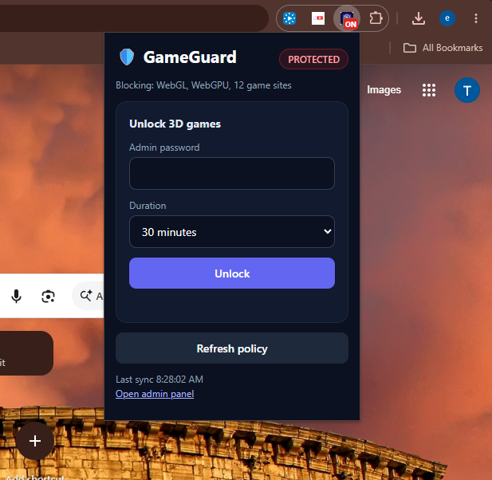
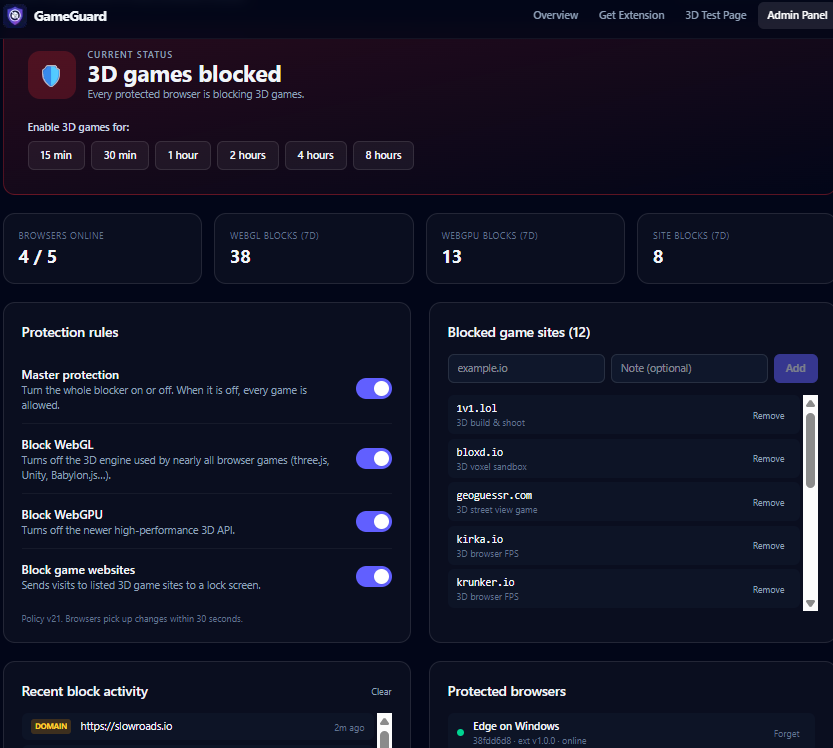

<div align="center">


# GameGuard

### Block 3D browser games by killing the tech they run on, not by chasing URLs.

**One Chrome extension. WebGL and WebGPU switched off on every site. Unlock only with an admin password.**

[](#-install-in-30-seconds)
[](#-install-in-30-seconds)
[](#-how-it-works)
[](#-privacy)
[](LICENSE)
[](https://github.com/YOUR-USERNAME/gameguard)

[**Install**](#-install-in-30-seconds) · [**10-second test**](#-prove-it-in-10-seconds) · [**How it works**](#-how-it-works) · [**FAQ**](#-faq) · [**Contribute**](#-contributing)

<!-- 👉 Put a 15-30 second demo GIF here. It is the single highest-impact thing in this file. -->
<!--  -->

⭐ **If this saves you from one more "just five more minutes" argument, a star helps other people find it.**

</div>

---

## 😤 The problem

You block `krunker.io`. Tomorrow there's a mirror. Then a proxy. Then an "unblocked games" site you've never heard of.

**URL blocklists are a game of whack-a-mole, and the moles are faster than you.**

## 💡 The fix

Almost every 3D browser game, whether built on three.js, Babylon.js, Unity WebGL, PlayCanvas or Godot, needs **WebGL** or **WebGPU** to draw a single frame.

GameGuard removes those APIs **before the page's own code runs**, on **every site and every frame**. The game can't create a 3D context, so it can't start. It doesn't matter what the domain is called.

> **No 3D context → no 3D game.**

A curated list of popular 3D game sites is blocked on top of that, as a second layer.

## 📸 See it

<div align="center">

| The toolbar popup | The admin dashboard |
|:---:|:---:|
|  |  |
| Status at a glance, password unlock with a timer | One-click unlocks, live block stats, rule toggles, device list |

</div>

## 🧪 Prove it in 10 seconds

1. Install GameGuard (below).
2. Visit [get.webgl.org](https://get.webgl.org). It normally shows a spinning cube.
3. With GameGuard on, you get no cube, because WebGL is gone.
4. Click the 🛡️ icon, enter the admin password, unlock, and refresh. The cube is back.

That is the whole product in one test.

## 🚀 Install in 30 seconds

```bash
git clone https://github.com/YOUR-USERNAME/gameguard.git
```

1. Open `chrome://extensions`
2. Turn on **Developer mode**
3. Click **Load unpacked** and pick the `gameguard` folder
4. Pin the 🛡️ icon. **ON** (red) means protected, **OFF** (green) means unlocked.

**Blocking starts instantly.** There is no account, no setup and no server required, because GameGuard ships with a built-in fail-closed policy. Works on Chrome 111+, Edge, Brave and other Chromium browsers.

## 🥊 Why not just use a blocklist?

| | URL blocklist | **GameGuard** |
|---|:---:|:---:|
| Blocks a game on a brand-new domain | ❌ | ✅ |
| Survives mirrors and "unblocked games" sites | ❌ | ✅ |
| Stops games embedded in iframes | Sometimes | ✅ |
| Also blocks known game sites | ✅ | ✅ |
| Timed password unlock that re-locks itself | Rare | ✅ |
| Works with zero setup | Varies | ✅ |
| Blocks 2D / HTML5 games | Only if listed | ❌ (by design) |

## ✨ Features

- 🧠 **Engine-level blocking.** Patches `getContext()` for every WebGL and WebGPU context type, hides `WebGLRenderingContext`, `navigator.gpu` and the `GPU*` constructors, and fakes `toString()` so the patch looks native.
- 🚪 **Closes the sneaky bypasses.** Blocks `transferControlToOffscreen()` and patches `OffscreenCanvas`. Injects into every frame, including `about:blank` iframes.
- ⚡ **Runs first.** Registered as a `MAIN`-world script at `document_start`, so games never get a GPU context before GameGuard does.
- 🌐 **Game-site blocklist.** `declarativeNetRequest` redirects 3D game domains and their subdomains to a friendly blocked page.
- 🔐 **Timed unlock.** 15 minutes up to 8 hours. Protection re-engages on its own, even offline.
- 🔒 **Fails closed.** If the policy has never loaded, everything is blocked. No server means no loophole.
- 🔄 **Re-lock kicks in live.** Open tabs on blocked sites get redirected, and pages already holding a 3D context get reloaded.
- 📊 **Admin dashboard.** A live web panel with block stats, one-click timed unlocks, rule toggles, a site list with notes, and a view of every protected browser.
- 📡 **Remote control.** Every browser syncs the central policy every 30 seconds.
- 🪶 **Tiny.** Plain JavaScript, no build step, no dependencies. You can read the whole thing in ten minutes.

## 👥 Who it's for

- 👨‍👩‍👧 **Parents** who want homework time to be homework time
- 🏫 **Teachers and schools** managing shared classroom Chromebooks
- 🧑‍💻 **IT admins** deploying focus policies by force-install
- 🧠 **Anyone fighting their own habits** and tired of "just one round"

## 🧩 How it works

```
┌──────────────────────────── Chrome ─────────────────────────────┐
│                                                                  │
│  Every page, every frame, at document_start                      │
│   ├─ block-webgl.js   getContext("webgl*") returns null          │
│   ├─ block-webgpu.js  navigator.gpu is undefined                 │
│   └─ relay.js         forwards "blocked" events safely           │
│                                                                  │
│  Known game domain  ──►  blocked.html  (password unlock form)    │
│                                                                  │
│  background.js (service worker)                                  │
│   ├─ syncs policy every 30s (optional server)                    │
│   ├─ registers / removes the blockers as policy changes          │
│   └─ handles unlock, status and reports                          │
└──────────────────────────────────────────────────────────────────┘
```

**Fail-closed logic:**

```
Server reachable?    → use the fresh policy and cache it
Server unreachable?  → use the cached policy
Never reached it?    → built-in default policy (block everything)
Unlock timer ended?  → re-block immediately, even offline
```

## 🖥️ Optional: admin server and panel

The extension works alone. Add a server if you want **remote policy control, password unlock, and block reports**.

Set it in `background.js`:

```js
const SERVER = "https://your-gameguard-server.example.com";
```

The server needs three endpoints:

| Endpoint | Purpose |
|---|---|
| `GET /api/policy?client=<uuid>&v=<version>` | Returns the current policy |
| `POST /api/unlock` with `{ password, minutes }` | Checks the password and sets `unlockUntil` |
| `POST /api/report` with `{ kind, url, detail }` | Receives block reports |

### 📊 The admin dashboard

An admin panel at `<your-server>/admin` is linked from the popup. From one screen you can:

- 🔓 **Enable 3D games for a set time** with one click: 15 min, 30 min, 1 h, 2 h, 4 h, or 8 h
- 📈 **Watch live stats**: browsers online, plus WebGL, WebGPU and site blocks over the last 7 days
- 🎚️ **Flip protection rules**: master switch, WebGL, WebGPU and game-site blocking
- 🌐 **Manage blocked sites**, each with an optional note ("3D build & shoot", "3D voxel sandbox")
- 🕵️ **See recent block activity**, with the site and how long ago it happened
- 💻 **See every protected browser** (for example "Edge on Windows"), whether it's online, its extension version, and a **Forget** button

Policy changes are versioned, and browsers pick them up **within 30 seconds**.

<details>
<summary><b>Policy format</b></summary>

```json
{
  "version": 1,
  "protectionEnabled": true,
  "blockWebGL": true,
  "blockWebGPU": true,
  "blockDomains": true,
  "domains": ["poki.com", "krunker.io", "minecraft.net"],
  "unlockUntil": null
}
```

| Field | Meaning |
|---|---|
| `protectionEnabled` | Master switch |
| `blockWebGL` / `blockWebGPU` | Disable each API on all sites |
| `blockDomains` | Enable the domain blocklist (subdomains included) |
| `domains` | Domains to block |
| `unlockUntil` | ISO date. While in the future, protection is paused |

</details>

<details>
<summary><b>Default blocked sites</b></summary>

`poki.com` · `shellshock.io` · `venge.io` · `1v1.lol` · `voxiom.io` · `kirka.io` · `krunker.io` · `minecraft.net` · `slowroads.io` · `geoguessr.com` · `playcanvas.com` · `bloxd.io`

</details>

<details>
<summary><b>Project structure</b></summary>

```
gameguard/
├── manifest.json       MV3 manifest
├── background.js       Sync, rules, unlock, reports
├── block-webgl.js      MAIN-world WebGL blocker
├── block-webgpu.js     MAIN-world WebGPU blocker
├── relay.js            Isolated-world event relay
├── blocked.html / .js  Blocked page with unlock form
├── popup.html / .js    Toolbar popup
├── ui.css              Shared dark UI
└── icon.png
```

</details>

## 🛡️ Make it hard to remove

Any user can disable an unmanaged extension. On managed devices, **force-install GameGuard** with the `ExtensionInstallForcelist` Chrome policy so it can't be turned off or removed. This works through Google Workspace admin, Intune and Group Policy.

## ❓ FAQ

<details>
<summary><b>Will it break normal websites?</b></summary>

Only ones that need WebGL or WebGPU, such as Google Earth, 3D map views and some design tools. That is the trade-off, and the timed unlock exists for exactly this.
</details>

<details>
<summary><b>Does it block 2D or HTML5 games?</b></summary>

No. It targets 3D and GPU games. 2D canvas games still run unless their site is on the blocklist.
</details>

<details>
<summary><b>Can a determined kid get around it?</b></summary>

On an unmanaged browser, they can disable or remove the extension, or use a different browser. Force-install it by policy and restrict other browsers to close that gap. No browser extension is tamper-proof on its own.
</details>

<details>
<summary><b>Does it need internet or an account?</b></summary>

No. Blocking works offline with zero setup. Only the password unlock and remote policy need a server.
</details>

<details>
<summary><b>What data does it collect?</b></summary>

None by default. See [Privacy](#-privacy).
</details>

## 🔒 Privacy

- No analytics, ads or third-party trackers
- The only network destination is the server **you** configure
- If you use a server, it receives a random per-install ID, the extension version, and block reports (page URL and what was blocked)
- The admin password goes to your server at unlock time only and is never stored in the extension

## 🗺️ Roadmap

- [ ] Reference admin server (Node) in this repo
- [ ] Per-site allowlist (for example, always allow Google Earth)
- [ ] Schedules ("games allowed Saturday 2 to 5 pm")
- [ ] Chrome Web Store release
- [ ] Firefox port
- [ ] Localized UI

Vote with a 👍 on an [issue](../../issues) or open a new one.

## 🤝 Contributing

The codebase is small on purpose, so it's a friendly place to start.

1. Fork the repo and create a branch
2. Load the unpacked extension and test on a few 3D sites
3. Open a PR explaining what changed and why

Look for [`good first issue`](../../labels/good%20first%20issue) labels. Easy wins include new default domains, UI polish, translations and docs.

## 📣 Share it

Know a parent, teacher or IT admin who fights this battle? [Post it on X](https://twitter.com/intent/tweet?text=GameGuard%3A%20a%20Chrome%20extension%20that%20blocks%203D%20browser%20games%20by%20disabling%20WebGL%20and%20WebGPU%20instead%20of%20chasing%20URLs&url=https%3A%2F%2Fgithub.com%2FYOUR-USERNAME%2Fgameguard) or send them the link.

## ⭐ Star history

<a href="https://star-history.com/#YOUR-USERNAME/gameguard&Date">
  
</a>

## 📄 License

[MIT](LICENSE) © YOUR NAME

<div align="center">

**Block the engine, not the website.** 🛡️

</div>
